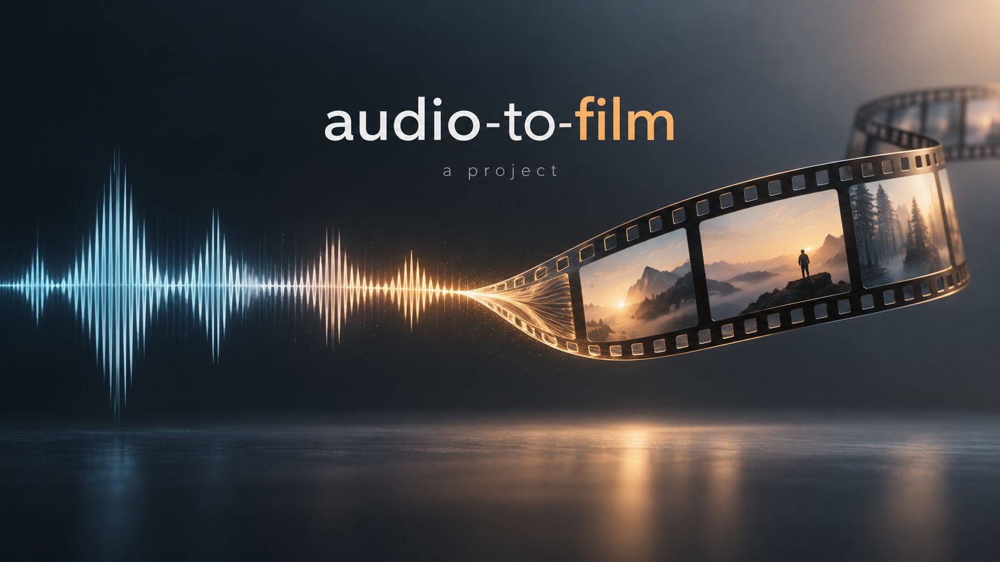
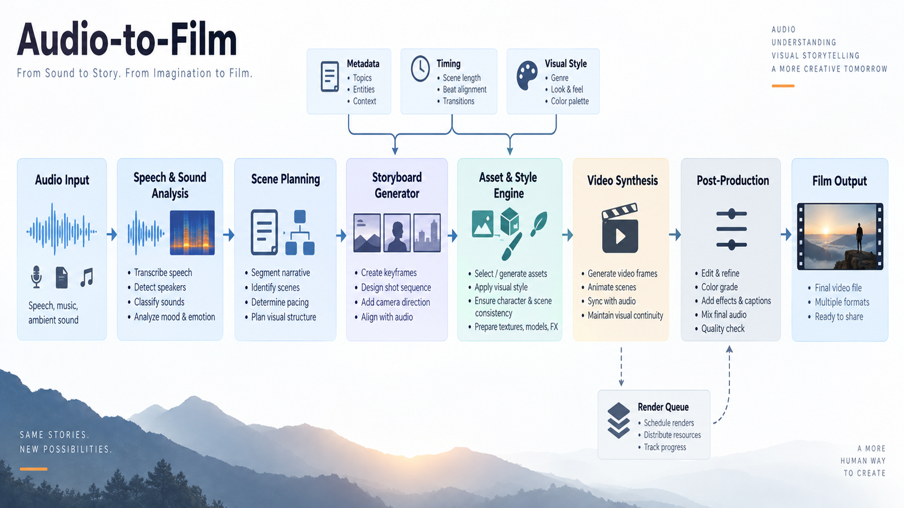
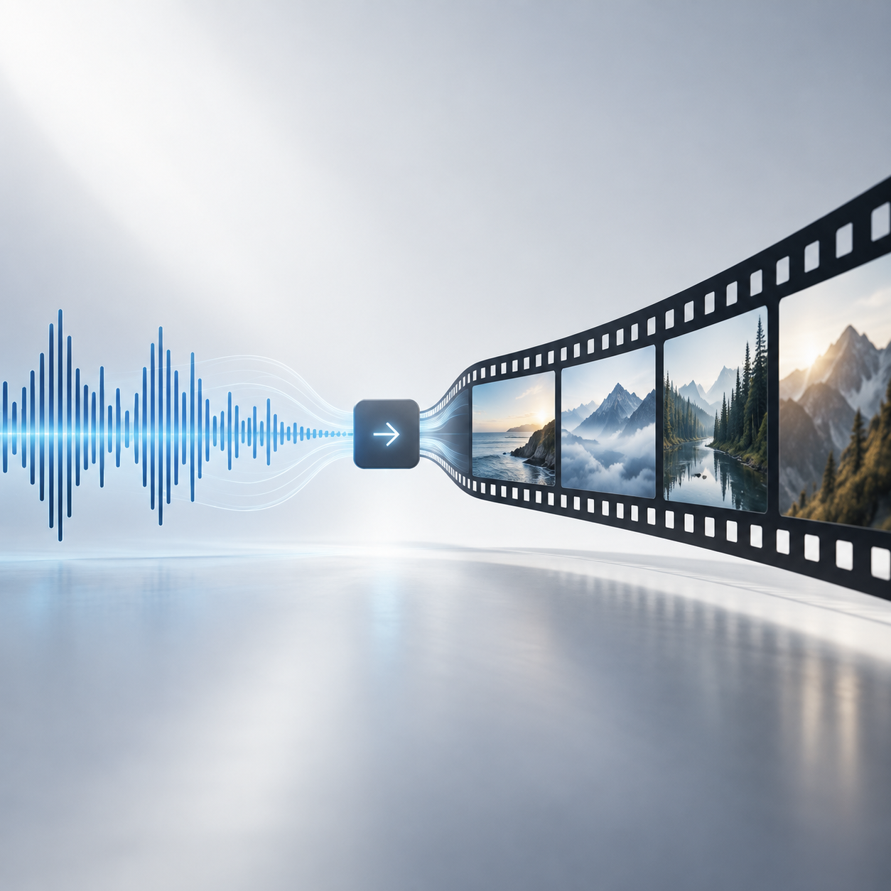
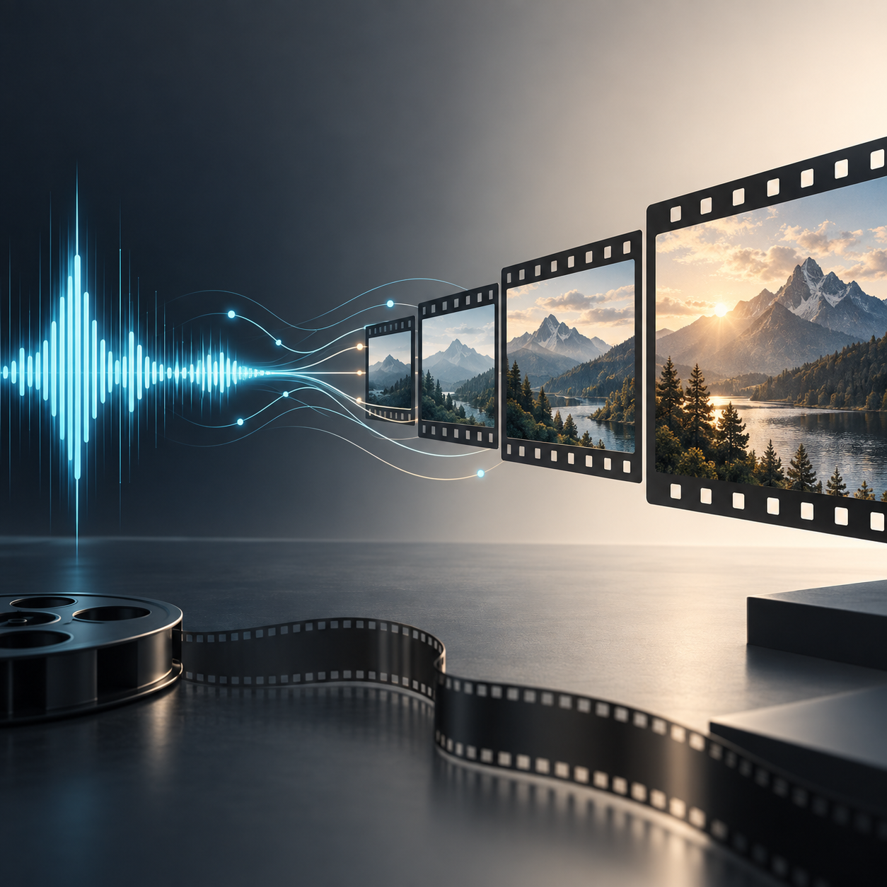
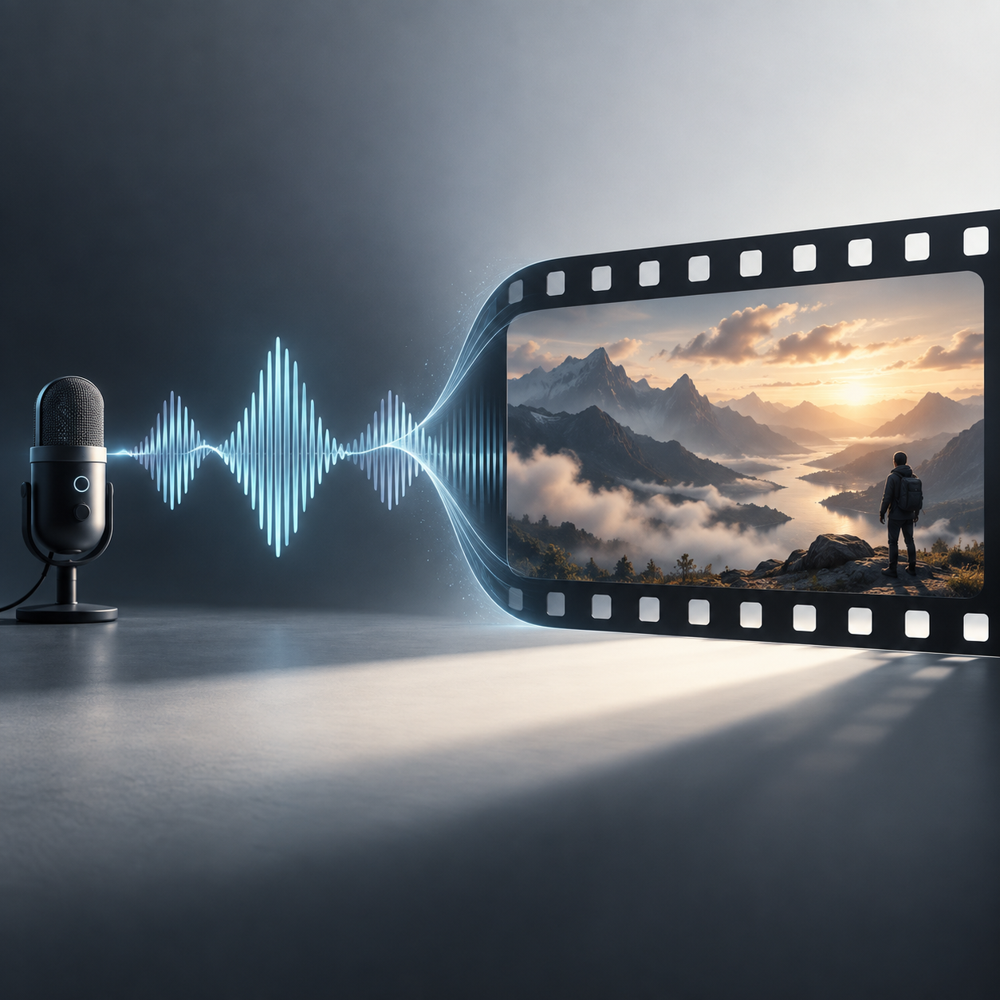

[English](README.md) | [한국어](README.ko.md)

# Audio to Film

Audio analysis, deterministic WebGL rendering, and agent-directed film production.



## Highlights

- Analyze stems, beats, sections, vocal features, and word timing.
- Render each frame from song time with three.js and headless Chrome.
- Resume segmented renders after interruptions.
- Author song-specific scenes instead of relying only on fixed templates.
- Check motion, lyric coverage, scene plans, and independent critique records.

This project extends existing open-source rendering and analysis code. Its additional work includes production orchestration and measurable quality checks.

## Quick Start

Requirements: Bun, Python 3.12 or 3.13, uv, FFmpeg/ffprobe, and Chrome. GPU rendering currently assumes macOS Metal. The Python interpreter that runs production and QA must have NumPy, SciPy, and OpenCV installed.

```bash
uv venv --python 3.12 .venv
uv pip install --python .venv/bin/python numpy scipy opencv-python
source .venv/bin/activate
```

The analysis directory uses its own uv environment. It does not install the root QA dependencies.

```bash
git clone https://github.com/VoidLight00/audio-to-film.git
cd audio-to-film
cd app && bun install && cd ..
cd analysis && uv sync && uv run python fetch_models.py && cd ..
bun run create-film -- /path/to/your-song.mp3 --draft
bash gates/verify_audio_to_film.sh .
```

Model downloads use network access and disk space. Use only audio and lyrics you have permission to process.

```bash
bun run create-film -- /path/to/your-song.mp3 --lyrics lyrics.txt
bun run create-film -- /path/to/your-song.mp3 --scale 2
bun run create-film -- --resume outputs/<run>
```

The authored-scene workflow requires a treatment, a timeline, scene modules, and independent review. See `.claude/skills/audio-to-film/SKILL.md` and `playbooks/`.

The generic v2 renderer works without private reference frames. The authored critic tools retain development reference paths. Before using them, prepare your own licensed reference sheets at `docs/research/frames/ref_cuts.png`, `docs/research/frames/ref_lyric_midpoints.png`, and `docs/research/frames/detail_crops_100pct.png`. Review the examples requested by `src/engineer_brief.py`. Those external source examples are not bundled. Do not mark a song final without actual reference evidence.

## Architecture

Decode → stem separation → music analysis → lyric timing → direction → segmented render → quality checks.



- `analysis/`: audio models and timing helpers.
- `app/src/engine/`: graphics, typography, and post-processing.
- `app/src/archetypes/`: reusable visual scenes.
- `app/src/songs/edit.ts`: song timing and anchor helpers.
- `src/`: production commands, frame metrics, plan and critic checks.
- `gates/`: executable checks.

## Gallery

These generated illustrations explain the project. They are not frames from a rendered film.





## Tools and ideas

Core tools include Demucs, audio-separator, Whisper, torchaudio, librosa, three.js, Vite, opentype.js, Playwright, OpenCV, and FFmpeg.

Additional studied projects include [phase-viz](https://github.com/7g3n/phase-viz), [particula](https://github.com/Humprt/particula), and [under-neon-lights](https://github.com/within-unlimited/under-neon-lights). Their contribution is limited to specific visual or audio-query ideas.

## Limits

This is an experimental engine, not a promise of automatic cinematic quality. Authored scenes require substantial work for each song. Automated checks do not replace visual review. The public export excludes the development song, lyrics, rendered films, private research, and session records.

No song-specific final film is included or certified by this repository. Generated README images are illustrative only.

The `frame_metrics.py --calibrate` command requires private development fixtures that are not included. Normal film measurement accepts your film and run directory. The existing thresholds are reference-specific and do not establish universal quality.

## License

Project additions use the MIT license. Existing third-party notices remain in `app/LICENSE.pdoom-video` and the bundled font license files. FFmpeg licensing depends on the installed build. Audio, lyrics, and model weights have separate terms.
